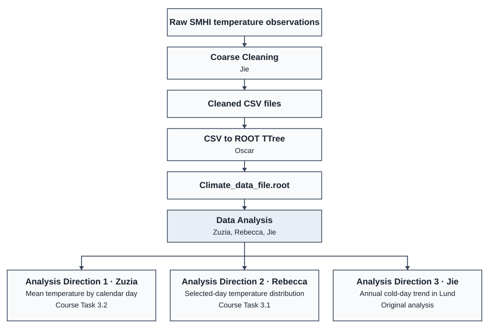

# Introduction:
This repository contains and documents the a solution to the final project of the course MNXB11 given at LU made and implemented by Team 3. The given task was to extract, format, and analyze a data set to extract and represent the data using the ROOT framework.

# Project structure: 
The project has been split into two major parts, with each part subsequently being split into subtasks.  

## Proposed Project Workflow



## Data Handling 
The data handling is the part where the raw data gets vetted and converted into a more manageable format for the data analysis and consists of:

### Data cleaning
Checks through the raw data and removes any files suspicious entries. 

To run the data cleaning:

* Ensure that all the prerequisite python libraries are installed
* Set the the path to the raw dataset in the [smhi_cleaner_four_steps.py](scripts/data_cleaning/smhi_cleaner_four_steps.py) script
  * Optionally change the limits set in the script
* Run:
```bash
python scripts/data_cleaning/smhi_cleaner_four_steps.py
```

### File processing 
The file processing part converts the outputted cleaned csv-files from the data cleaning part and converts it into a TTree stored in a `.root` file using the class `ClimateData`. 

To run the file Processing:

* Locate the cleaned data files that are to be processed
  * Ensure that all the files are in the same directory
* Set the `CLEAN_DATA_PATH` in [config.txt](scripts/csv_to_ttree/config.txt) to the directory containing all the data files that are to be processed
* Add the filenames of all the files to `FILENAMES` in [config.txt](scripts/csv_to_ttree/config.txt)
* Run the following in the root of this repository:
```bash
scripts/csv_to_ttree/process_files.sh
```


## Data Analysis
The data analysis is where the data actually gets used and represented. This project covers 3 different ways to analyze the data, those being:

1. Zuzia — Mean temperature for each calendar day across years ([Task 3.2 figures](plots/daily_mean_temperature/)).
2. Rebecca — Temperature distribution for a selected calendar day across years ([Task 3.1 figures](plots/selected_day_temperature/)).
3. Jie — [Annual cold-day trend in Lund](scripts/data_analysis_topic_3.md) ([figures and data](plots/lund_cold_days/)).

From the repository root inside the MNXB11 container, build and run all three analyses with the shared executable:

```bash
make
./main
```

The executable reads `Climate_data_file.root` from the repository root. If that file needs to be regenerated, follow the data handling steps above. From the course host, the existing wrappers `bash scripts/buildproject.sh` and `bash scripts/runproject.sh` perform the same build and run steps inside the container.