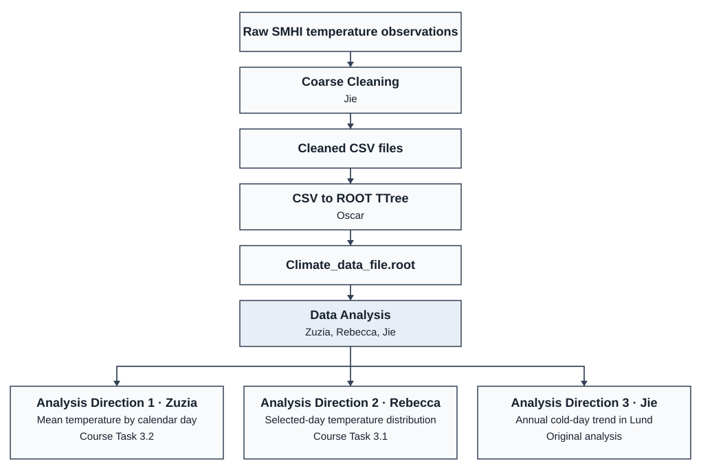

# MNXB11 Final Project Work Plan

Team 3 — Rebecca Batchelor, Zuzanna (Zuzia) Popek, Jie Qi, and Oscar Tang.

## Project workflow

## Data handling

| Stage | Owner | Tasks and deliverables |
| --- | --- | --- |
| Coarse cleaning | Jie Qi | Check field format, timestamp order, temperature-change rate, and temperature range. Keep the raw SMHI files intact and produce cleaned station CSVs and deletion logs. Maintain the C++ batch cleaner and the optional interactive Python cleaner. |
| File processing | Oscar Tang | Prepare the `ClimateData` class and convert the cleaned station CSVs into a shared ROOT `TTree`. Maintain the batch conversion script and check that its output contains the expected stations and fields. |

## Data analysis and figures

| Direction | Owner | Tasks and deliverables |
| --- | --- | --- |
| 1 — Mean temperature by calendar day (Task 3.2) | Zuzanna Popek | Calculate the mean temperature for each calendar day across the available years and prepare the corresponding [figure](plots/daily_mean_temperature/). |
| 2 — Temperature distribution for a selected day (Task 3.1) | Rebecca Batchelor | Calculate the temperature distribution for a selected calendar day across years and prepare the [histograms](plots/selected_day_temperature/). |
| 3 — Annual cold-day trend in Lund (original analysis) | Jie Qi | Count days with a daily mean below 0 °C for each observed year, fit the trend, and document the method and [reference results](plots/lund_cold_days/). |

## Integration and report

- **Shared analysis build — Jie Qi, Zuzanna Popek, and Rebecca Batchelor.** Keep the three analyses callable from the shared executable, verify the figures, and check that each plot has a title, labelled axes, and units where applicable.
- **Data preparation documentation — Jie Qi and Oscar Tang.** Document cleaning and CSV-to-ROOT conversion so the analysis input can be recreated.
- **Scientific report — all four team members.** Document the method and results for each assigned part in the [LaTeX report](LaTeX/main.tex). Each analysis owner checks the figures and interpretation for their section.
