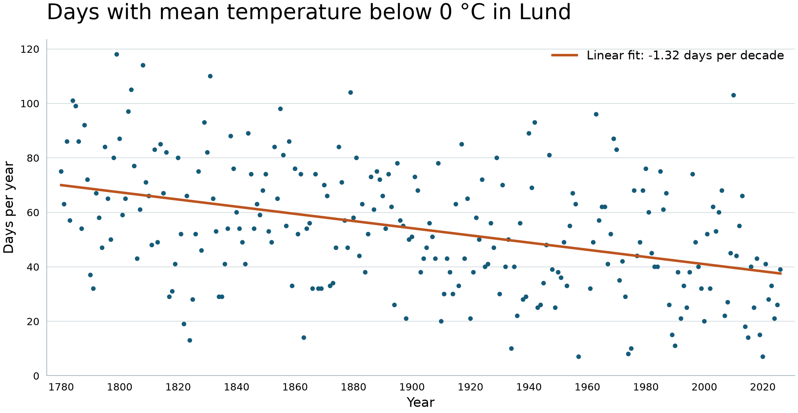

# Cold days in Lund

How many days each year had a mean temperature below 0 °C in Lund? The fitted trend in the available records is **1.32 fewer cold days per decade**.

## How the count works

The program reads the Lund measurements from the ROOT tree in date order. For each day it adds the readings in tenths of a degree. A negative sum means the daily mean was below zero, so the day counts once. A mean of exactly zero does not count.

Each point represents one year with observations. Missing days are skipped, and a year with no observations has no point. Incomplete years can therefore have lower counts. ROOT fits a straight line to the yearly counts with `TGraph::Fit("pol1")`. Multiplying the slope by ten gives the change in days per decade.

## Run in the MNXB11 container

Follow the [shared build and run instructions](../../README.md#data-analysis). Running the shared executable runs all three analyses using `Climate_data_file.root`.

The Lund analysis prints the fitted slope and saves `lund_cold_days.png` and `lund_cold_days.pdf` in the working directory. Yearly counts stay in memory.

## Reference results

The [yearly counts](lund_cold_days.csv) cover 244 years with observations between 1780 and 2026. The preview above and its [PDF version](../../plots/lund_cold_days/reference_plot.pdf) were plotted separately from those counts. Running the C++ program draws the data using ROOT's default style.
